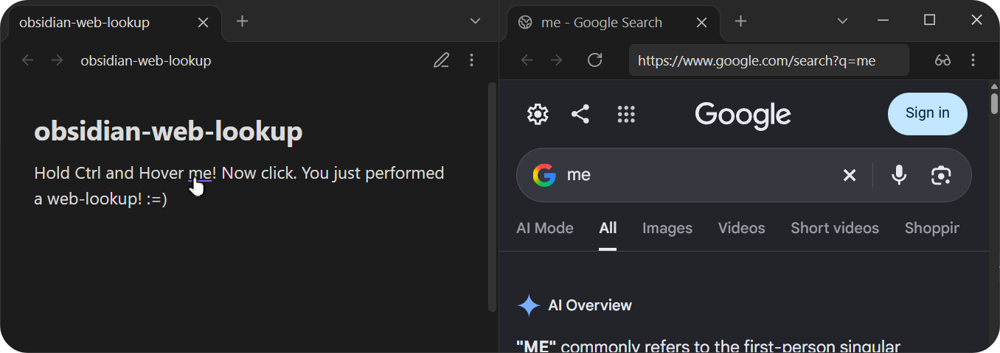

# Web-Lookup (an Obsidian Community plugin)

**Hold Ctrl → hover a word → left-click → web search for that word.**
Works in the editor (source + live preview), reading view, canvas text cards and the PDF viewer.

## Settings → behavior
| Setting | Meaning |
|---|---|
| Open in browser | External system browser, or the built-in **Web viewer** core plugin (desktop). Falls back to external if Web viewer is off/unavailable. |
| Open in tab | New tab / current tab (Web viewer only). |
| Search engine | Google, DuckDuckGo, Bing, Yandex, Baidu. |
| Modifier key (extra) | Ctrl by default; Alt/Shift/Cmd available (Ctrl+click is "right click" on macOS). |
| Let Obsidian handle links (extra) | Ctrl+click on links keeps its normal behavior. |
| Delimiters | Unicode word boundaries (`Intl.Segmenter`, handles CJK/Thai), whitespace only, or whitespace + custom characters. |
| Punctuation | *Split*: punctuation separates tokens · *Keep inside words*: `don't`, `well-known` stay whole, edges trimmed · *Keep all*: punctuation stays attached. |
| Case sensitivity / Normalization | Applied to the **search string only** (preserve / lower / upper; none / NFC / NFD / NFKC / NFKD / strip diacritics). They never invalidate caches. |

## Caching
Tokenization works on "blocks" (editor line, reading-view paragraph, **PDF page**). Token boundaries per block are cached, keyed by a hash of the block text, so stale data is impossible.

* **RAM cache** – per file, recency ordered.
  * *Sliding window = yes*: only the N most recently used blocks per file stay in memory.
  * *no*: unbounded per file; a global 1M-token limit evicts least-recently-used files.
* **Permanent cache** – one JSON per file in `<plugin>/cache/`, written ~4 s after new blocks are cached. A file is written to disk when:
  * its extension is in **always file types** (default `pdf`), **or** it is inside an **always directory**, **or**
  * every threshold that is > 0 is met: file **unmodified for ≥ N days** (mtime threshold) **and** cached **tokens ≥ N** (token-count threshold). Both 0 = this rule is off.
  * Disk caches are discarded automatically when the file's mtime/size or the tokenizer settings change.
* **Lazy loading** – *yes*: a file's disk cache is read the first time you use that file. *no*: all cache files are loaded at startup.

## Notes / limits
* The Web viewer core plugin has no public API; the plugin opens it with view type `webviewer` and state `{ url, navigate: true }` and falls back to the external browser if that fails.
* Token highlighting uses the CSS Custom Highlight API (no DOM changes inside the editor or PDF).
* The cache directory lives in the plugin folder; exclude `cache/` from vault sync if you don't want it synced.
